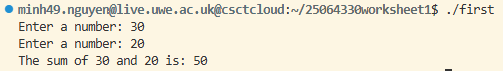
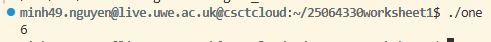
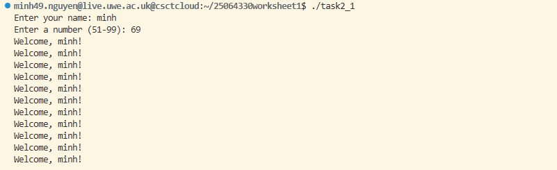
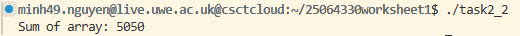
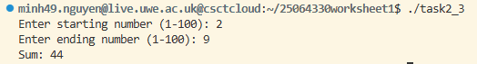

# Operating Systems – Worksheet 1
## An Echo of Assembler

**Student:** [Your Name]  
**Student ID:** [Your Student ID]  
**Module:** UFCFWK-15-2 Operating Systems

---

# Introduction

This worksheet explores basic assembly language programming and how assembly can interact with C programs.

The main objectives are:
- Understanding basic assembly instructions.
- Calling assembly functions from C.
- Using loops and conditional statements in assembly.
- Creating and using arrays.
- Using Makefiles to automate compilation.

# Task 1 – Basic Assembly Programming

## Task 1.1 – Adding Two Integers

The first program adds two integers stored in memory and displays the result.

### Implementation

The program uses the `mov` instruction to load values into registers and the `add` instruction to perform addition.

Example code snippet:

```nasm
mov eax, [integer1]
add eax, [integer2]
mov [result], eax
```

Explanation:
- `mov` loads the first integer into EAX.
- `add` adds the second integer to EAX.
- The result is stored in memory.

### Program output



## Task 1.2 – Second Assembly Program

This program implements the example from lecture slide 22.

### Implementation

[Explain what your second assembly program does.]

Example code snippet:

```nasm
; Insert a short relevant code snippet here
```

Explanation:

[Explain the purpose of the instructions and how the program produces its result.]

### Program output



---

# Task 2 – Loops and Conditionals

## Task 2.1 – Welcome Message

This program asks the user for their name and a number.

It checks whether the number is greater than 50 and less than 100. If the number is valid, it prints a welcome message the specified number of times. Otherwise, it displays an error message.

### Implementation

Example code snippet:

```nasm
cmp eax, 50
jle error

cmp eax, 100
jge error
```

Explanation:
- `cmp` compares the number against a specified value.
- `jle` jumps to the error section if the number is less than or equal to 50.
- `jge` jumps to the error section if the number is greater than or equal to 100.

A loop is used to repeat the welcome message.

### Program output



## Task 2.2 – Array Summation

This program creates an array containing 100 integers, from 1 to 100.

It uses a loop to access each element and calculate the total sum.

### Implementation

[Insert a short code snippet from your array and summation loop.]

Explanation:

The program iterates through the array, adding each element to an accumulator until all 100 elements have been processed.

The expected result is:

**1 + 2 + 3 + ... + 100 = 5050**

### Program output



## Task 2.3 – User-Defined Range Summation

This program extends the previous array summation program.

It asks the user to enter a starting and ending number. It validates the range and calculates the sum of the numbers within the selected range.

### Implementation

[Insert a short code snippet showing your range validation and summation loop.]

Explanation:

The program checks that the entered range is valid before calculating the sum. It then iterates through the selected numbers and accumulates their values.

### Program output



---

# Task 3 – Makefile

A Makefile automates the process of compiling and linking the C and assembly programs.

Instead of manually executing several compiler commands, the `make` command can build the required programs.

### Implementation

The Makefile contains rules defining:
- Targets: The executable programs to generate.
- Prerequisites: The source and object files required.
- Recipes: The commands used to compile and link the programs.

Example:

```makefile
all: task1 task1_2

task1: driver.o task1.o asm_io.o
	gcc -m32 driver.o task1.o asm_io.o -o task1
```

The `all` target allows multiple programs to be built using one command.

### Building the programs

```bash
make
```

### Cleaning generated files

```bash
make clean
```

### Program output


---

# Compilation and Execution

The programs can be compiled using NASM and GCC.

Example commands:

```bash
nasm -f elf task1.asm -o task1.o
nasm -f elf asm_io.asm -o asm_io.o
gcc -m32 -c driver.c -o driver.o
gcc -m32 driver.o task1.o asm_io.o -o task1
```

The executable can then be run using:

```bash
./task1
```

Alternatively, the Makefile can automate the compilation process using:

```bash
make
```

---

